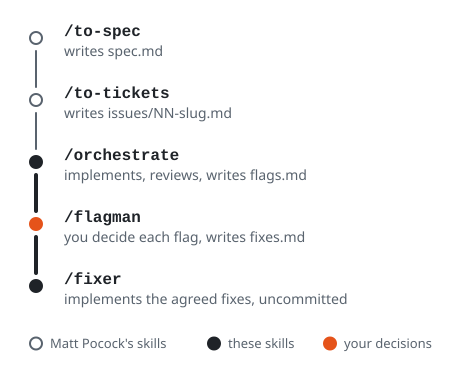

<p align="center">
  <picture>
    <source media="(prefers-color-scheme: dark)" srcset="assets/mark-dark.svg">
    
  </picture>
</p>

<h1 align="center">orchestrate-skills</h1>

<p align="center">
  Three Claude Code skills that take a directory of tickets to reviewed commits.<br>
  Then they walk you through whatever still needs a human decision.
</p>

<p align="center">
  <picture>
    <source media="(prefers-color-scheme: dark)" srcset="assets/flow-dark.svg">
    
  </picture>
</p>

## Skills

| Skill | Invoked as | What it does |
| --- | --- | --- |
| [orchestrate](skills/orchestrate/SKILL.md) | `/orchestrate <issues-dir> [model] [--parallel[=N]]` | Runs one fresh subagent per ticket on the current branch, reviews the whole run, runs fix rounds, and writes what needs you to `flags.md`. Never pushes or opens a PR. |
| [flagman](skills/flagman/SKILL.md) | `/flagman <path/to/flags.md>` | Walks `flags.md` one entry per turn. You answer fix or ignore, and agreed fixes are copied to `fixes.md`. |
| [fixer](skills/fixer/SKILL.md) | `/fixer <path/to/fixes.md> [model]` | Implements the agreed fixes in `fixes.md` with fresh subagents. Commits nothing. |

## Usage

```text
/orchestrate .scratch/<feature-slug>/issues
/flagman .scratch/<feature-slug>/flags.md
/fixer .scratch/<feature-slug>/fixes.md
```

`/orchestrate` refuses to start on a dirty working tree, because ticket agents commit. `--parallel` runs up to N tickets at once in git worktrees and is described in [PARALLEL.md](skills/orchestrate/PARALLEL.md).

## Why these exist

Matt Pocock's skills produce the spec and the tickets, and his `implement` skill builds one piece of work from them. These three skills cover what was still done by hand around that.

- **Running a whole ticket set.** `/orchestrate` works through every ticket in dependency order, with one fresh subagent per ticket, and verifies each one's commits before starting the next.
- **A correctness review on top of the spec review.** Matt's `code-review` checks the work against the spec and the repo's standards. Code can pass that and still be wrong, so every ticket and the run as a whole also get Claude Code's built-in correctness review.
- **A short list for the human.** Early runs put every review finding into `flags.md`. Fix rounds now settle the findings that have one obvious fix, so what remains is what needs your input.
- **One decision per turn.** Going over `flags.md` by hand in a new session every time became `/flagman`, which gives a summary and a recommendation for each entry and asks fix or ignore.
- **Deciding apart from fixing.** `/flagman` only evaluates and records what you agreed to. `/fixer` implements those fixes afterwards with fresh subagents.
- **A history of the feature.** `flags.md` keeps every finding, marked `[fixed]`, `[refused]` or `[agreed]`, and a corrected spec or ticket line keeps its old text as `[was: ...]`.

## Prerequisites

### Matt Pocock's skills (required)

> [!IMPORTANT]
> This flow is built on top of [mattpocock/skills](https://github.com/mattpocock/skills) and does not run without them.

`/orchestrate` reaches them in two ways, so both have to be in place.

1. The Claude Code plugin. Ticket agents call `mattpocock-skills:tdd` and `mattpocock-skills:code-review` by their plugin names. They read the `implement` skill's file from the plugin's install directory, because a subagent cannot expand `/implement`.

   ```bash
   claude plugin install mattpocock-skills@claude-plugins-official
   ```

2. Tickets in his local-markdown layout. Run `/setup-matt-pocock-skills` once per repo and pick local files as the issue tracker, then produce the spec with `/to-spec` and the tickets with `/to-tickets`. That gives `/orchestrate` what it expects:

   ```text
   .scratch/<feature-slug>/spec.md
   .scratch/<feature-slug>/issues/<NN>-<slug>.md    **Status:** ready-for-agent, **Blocked by:** ...
   ```

### Also required

- Claude Code's built-in `code-review` skill, which the correctness reviews call at `xhigh`.

## Install

```bash
npx skills@latest add orkhanfarmanli/orchestrate-skills -g
```

Or copy the three directories under `skills/` into `~/.claude/skills/`.

Installed skills do not update themselves. Pull the latest with:

```bash
npx skills@latest update orchestrate flagman fixer -g
```
